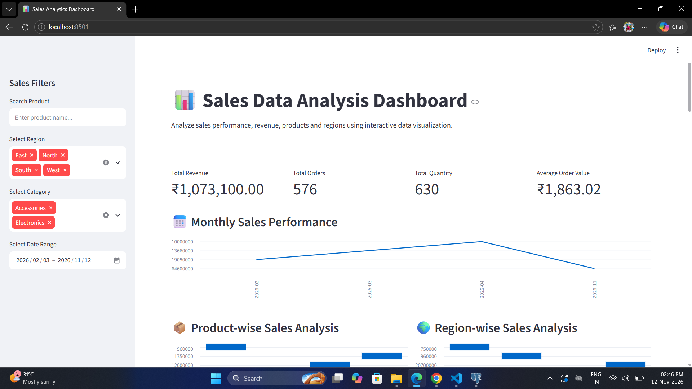
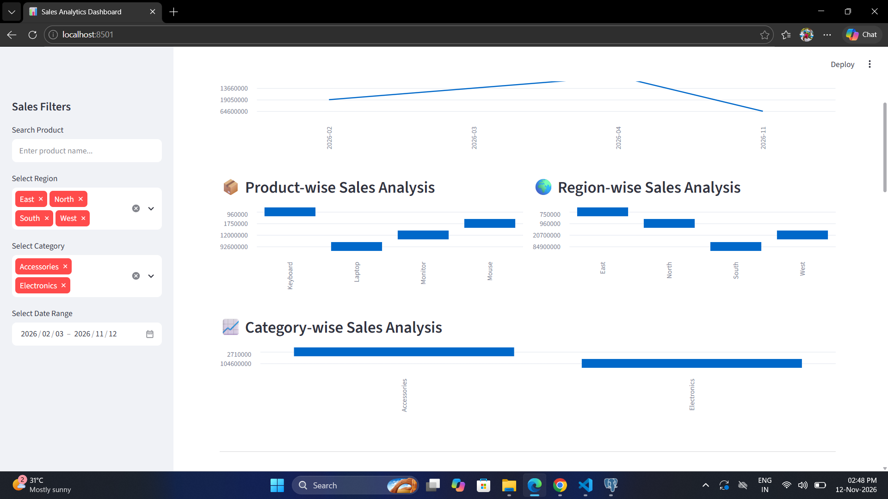
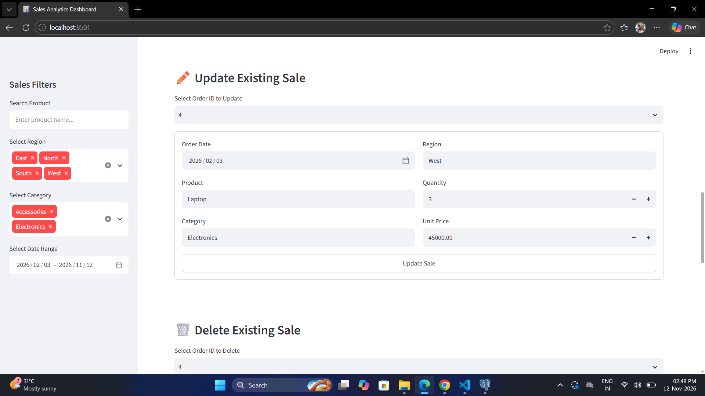
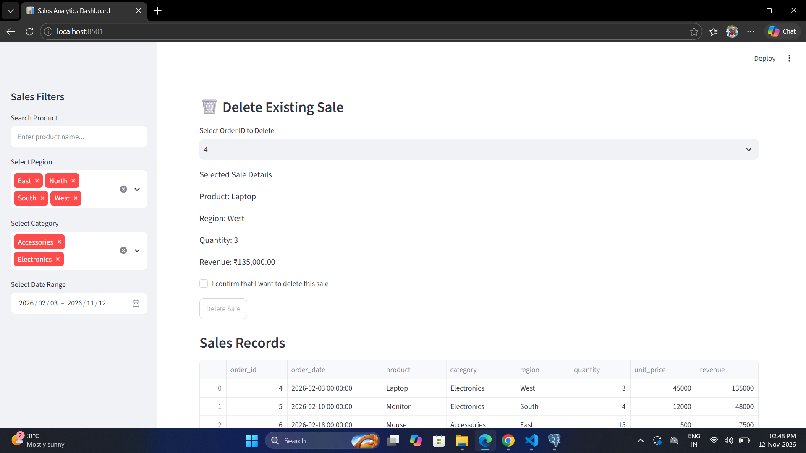

# Sales Data Analysis System

A Python-based Sales Data Analysis System that helps analyze sales performance through an interactive dashboard. The application uses PostgreSQL for data storage and Streamlit for visualization and sales record management.

## Project Overview

This project analyzes sales data to identify revenue trends, product performance, regional sales, and category-wise performance. Users can also manage sales records through CRUD operations.

## Technologies Used

- **Python** – Programming language
- **Pandas** – Data manipulation and analysis
- **NumPy** – Numerical operations
- **Matplotlib** – Data visualization
- **Streamlit** – Interactive dashboard
- **PostgreSQL** – Database management
- **Psycopg** – PostgreSQL connectivity

## Key Features

- Interactive sales analytics dashboard
- Total Revenue, Total Orders, Total Quantity and Average Order Value KPIs
- Monthly sales analysis
- Product-wise sales analysis
- Region-wise sales analysis
- Category-wise sales analysis
- Product search
- Region and category filters
- Date range filtering
- Add, update and delete sales records
- CSV data export
- PostgreSQL database integration

## Project Structure

```text
Sales_Data_Analysis/
│
├── app.py
├── main.py
├── database.py
├── db_config.example.py
├── import_data.py
├── test_connection.py
├── sales_data.csv
├── output/
│
├── .gitignore
└── README.md
```

## Installation and Setup

### 1. Clone the Repository

```bash
git clone https://github.com/YOUR_USERNAME/Sales-Data-Analysis-System.git
```

### 2. Navigate to the Project Folder

```bash
cd Sales-Data-Analysis-System
```

### 3. Create a Virtual Environment

```bash
python -m venv venv
```

### 4. Activate the Environment (Windows)

```bash
venv\Scripts\activate
```

### 5. Install Required Libraries

```bash
pip install pandas numpy matplotlib streamlit "psycopg[binary]"
```

### 6. Configure PostgreSQL

- Create a PostgreSQL database named `sales_db`.
- Create the required `sales` table.
- Copy `db_config.example.py` to `db_config.py`.
- Update your local database username and password in `db_config.py`.
- Keep your actual database credentials private.

### 7. Import Dataset

```bash
python import_data.py
```

Run this only when the database table is empty, because the import script checks for existing records.

### 8. Launch the Dashboard

```bash
streamlit run app.py
```

## Database

Database: PostgreSQL

Table: `sales`

The database stores order date, product, category, region, quantity and unit price.

## Future Enhancements

- Sales forecasting using Machine Learning
- Advanced business intelligence reports
- User authentication and role-based access
- Automated report generation

## Author

**Sairam R**

GitHub: https://github.com/YOUR_USERNAME

LinkedIn: https://www.linkedin.com/in/sairam-r-60631b37a

## License

This project is developed for educational and portfolio purposes.

## Dashboard Screenshots

### Main Dashboard


### Sales Analysis


### CRUD Operations



